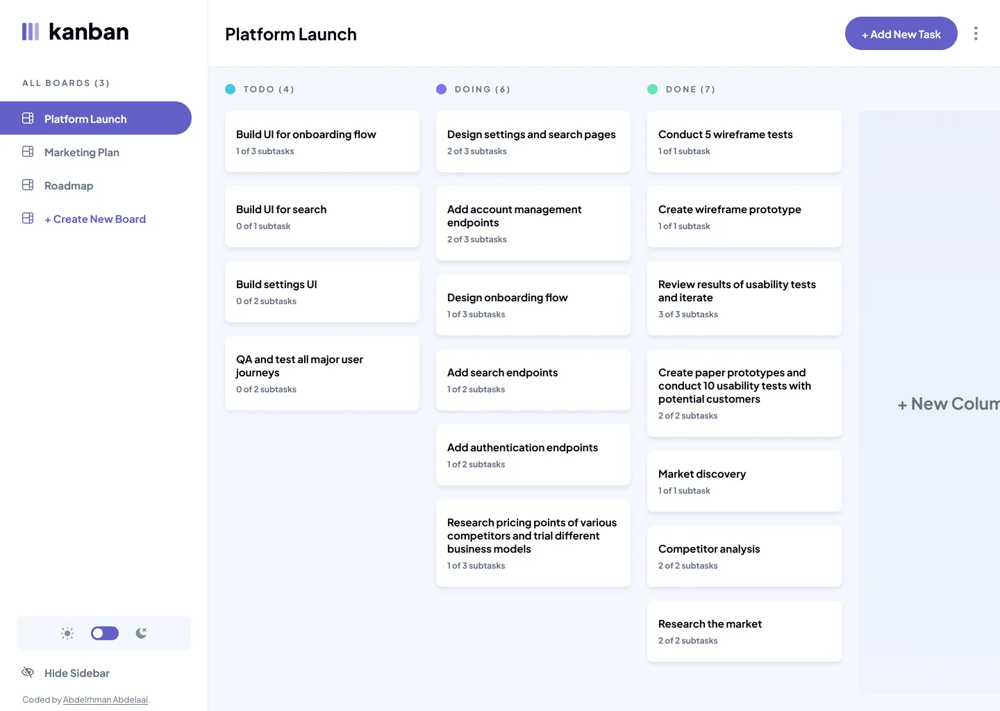

# Kanban task management web app

My solution to the [Kanban task management web app](https://www.frontendmentor.io/challenges/kanban-task-management-web-app-wgQLt-HlbB) challenge on Frontend Mentor.

- Live: https://kanban-task-management-web-app.abdelrhman-ahmed8881.workers.dev
- Code: https://github.com/MrBlackvanta/kanban-task-management-web-app

## Built with

- Next.js
- React
- TypeScript
- Tailwind CSS
- Cloudflare Workers
- Cloudflare D1

## Author

- [LinkedIn](https://www.linkedin.com/in/abdelrhman-vanta/)
- [UpWork](https://www.upwork.com/freelancers/mrblackvanta)
- [Frontend Mentor](https://www.frontendmentor.io/profile/MrBlackvanta)
